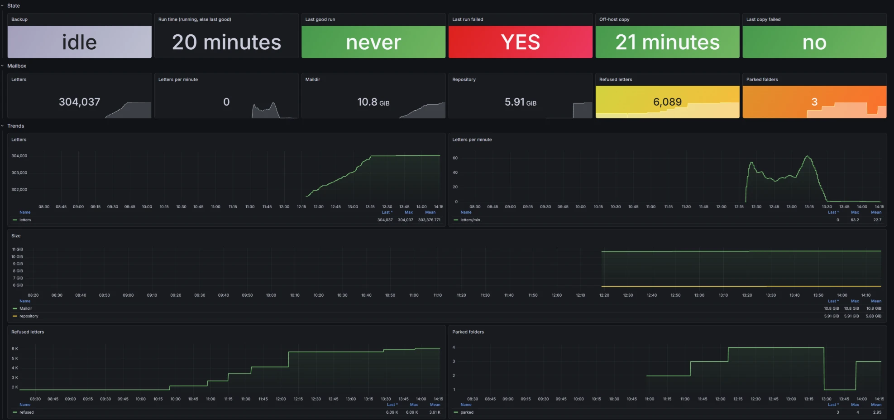

# mbsync-restic-backup

[](https://github.com/adsdevdoo/mbsync-restic-backup/actions/workflows/build.yml)
[](https://github.com/adsdevdoo/mbsync-restic-backup/pkgs/container/mbsync-restic-backup)
[](https://hub.docker.com/r/adsdevdoo/mbsync-restic-backup)
[](https://hub.docker.com/r/adsdevdoo/mbsync-restic-backup)
[](https://hub.docker.com/r/adsdevdoo/mbsync-restic-backup)

[](https://github.com/adsdevdoo/mbsync-restic-backup/releases)
[](LICENSE)
[](https://github.com/adsdevdoo/mbsync-restic-backup/commits/main)

[English](README.md) | **Русский**

Ежедневный бэкап одного почтового ящика по IMAP в одном Docker-контейнере.

[mbsync](https://isync.sourceforge.io/) скачивает все папки в локальный Maildir, [restic](https://restic.net/) делает
снимки. По желанию репозиторий restic копируется на второй сервер по SSH. Синхронизация односторонняя: на сервере
ничего не меняется, локально ничего не удаляется, поэтому удалённое из ящика письмо остаётся в бэкапе.

Сделан для ящика в Яндекс 360, который после аварии в дата-центрах Яндекса рвал сессии и не отдавал часть писем.
Как подготовить Яндекс 360 к IMAP, по шагам со скриншотами: [docs/yandex-360.md](docs/yandex-360.md).



Ограничения: только TLS сразу (порт 993, `TLSType IMAPS`) и только вход по паролю (`AuthMechs LOGIN`). STARTTLS на
143 и OAuth нет, поэтому с Microsoft 365 после отключения basic auth не заработает. Для Gmail исключите
`[Gmail]/All Mail` (см. `EXTRA_PATTERNS`), иначе весь ящик сохранится дважды.

## Возможности

- **Односторонний, ничего не теряет.** Только скачивание: ящик не меняется, удалённые письма остаются в бэкапе.
- **Снимки, а не зеркало.** restic хранит дневные, недельные и месячные снимки, с дедупликацией и шифрованием.
- **Переживает капризный сервер.** Перезапускается после обрыва сессии и продолжает с места остановки, даже в
  папках, которые не пройти за одну сессию; ведёт список писем, которые сервер не отдал, и потом просит их снова.
- **Счётчики по папкам:** сколько писем на сервере, у нас и в отказах — видно, что осталось, без сверки руками.
- **Параллельные сессии** для медленных серверов.
- **Копия на другой машине** по SSH, ключом, который может только добавлять файлы.
- **Метрики и дашборд Grafana**, обновляются прямо во время синхронизации.
- **Один контейнер**, amd64 и arm64, настройки в `.env`.

## Быстрый старт

```sh
git clone https://github.com/adsdevdoo/mbsync-restic-backup.git && cd mbsync-restic-backup
cp .env.example .env                 # DATA_DIR, IMAP_HOST, IMAP_USER
mkdir -p secrets && chmod 700 secrets
read -rs p && printf '%s' "$p" > secrets/imap_password; unset p
head -c 32 /dev/urandom | base64 > secrets/restic_password && chmod 600 secrets/*
mkdir -p /srv/mail-backup            # DATA_DIR из .env
docker compose pull && docker compose up -d && docker exec mail-backup backup.sh init
```

Первый бэкап пройдёт по расписанию (04:30). Как запустить его сразу и что сохранить в менеджер паролей — в разделе
[Установка](#установка).

## Теги образа

Образы для `linux/amd64` и `linux/arm64`, одинаковые в обоих реестрах:

- `ghcr.io/adsdevdoo/mbsync-restic-backup`
- [`adsdevdoo/mbsync-restic-backup`](https://hub.docker.com/r/adsdevdoo/mbsync-restic-backup) (Docker Hub)

| Тег | Что это | Когда брать |
|---|---|---|
| `latest` | последний релиз | нужны релизы, без закрепления |
| `1`, `1.2`, `1.2.3` | последний `1.x.x`, последний `1.2.x`, ровно `1.2.3` | `1`: обновления без ломающих изменений; `1.2.3`: ничего не меняется, пока не решите сами |
| `edge` | текущий `main`, ещё не выпущен | попробовать, что будет дальше |
| `sha-abc1234`, полный SHA коммита | один конкретный коммит | закрепить установку за коммитом |

`compose.yml` запускает `latest`. Другой тег или свою сборку задаёт `IMAGE` в `.env`
(`docker build -t mbsync-restic-backup:local .`, затем `IMAGE=mbsync-restic-backup:local`).

Версии идут по [Semantic Versioning](https://semver.org/lang/ru/): новая старшая версия значит, что от вас что-то
потребуется (настройки, раскладка данных, имена метрик). Изменения — в [CHANGELOG.md](CHANGELOG.md) и на
[странице релизов](https://github.com/adsdevdoo/mbsync-restic-backup/releases).

## Что делает прогон

1. **Подсчёт.** Сколько писем в каждой папке на сервере (IMAP `STATUS`, одно соединение) — для метрик по папкам.
2. **Синхронизация.** mbsync скачивает новые письма из всех папок в `DATA_DIR/maildir`. Если сервер оборвал
   соединение, mbsync запускается снова, до 3 раз за прогон, и продолжает с места остановки (см.
   [Большие папки](#большие-папки)). С `PARALLEL=N` папки
   делятся на N групп, у каждой своя сессия, все работают одновременно. Это помогает, когда сервер медленно отвечает:
   у каждой сессии своя очередь. Серверы ограничивают число одновременных IMAP-соединений (Gmail — 15, Яндекс свой
   лимит не публикует): начните с 2.
3. **Снимок.** restic снимает Maildir в `DATA_DIR/restic`. Хранится 30 дневных, 8 недельных и 24 месячных снимка.
   Раз в неделю `restic check` читает 10% данных. Если синхронизация не удалась, снимок всё равно делается, но
   ротация пропускается и прогон считается упавшим.
4. **Копия** (по желанию). rsync отправляет на второй сервер файлы репозитория, которых там ещё нет.

Планировщик (supercronic) по умолчанию запускает прогон каждый день в 04:30. Два прогона одновременно не идут.

## Установка

Нужен Docker с Compose и каталог для данных. Какой тег образа взять — в разделе [Теги образа](#теги-образа).

```sh
git clone https://github.com/adsdevdoo/mbsync-restic-backup.git
cd mbsync-restic-backup
cp .env.example .env               # задать DATA_DIR, IMAP_HOST, IMAP_USER
mkdir -p secrets && chmod 700 secrets
read -rs p && printf '%s' "$p" > secrets/imap_password; unset p     # ввести пароль IMAP, Enter
head -c 32 /dev/urandom | base64 > secrets/restic_password
chmod 600 secrets/*
mkdir -p /srv/mail-backup          # DATA_DIR из .env
docker compose pull && docker compose up -d
docker exec mail-backup backup.sh init
```

**Сохраните `secrets/restic_password` в менеджер паролей.** Без него снимки не открыть.

Первая выгрузка большого ящика занимает часы. Запустите её сразу, не дожидаясь расписания, отдельно от своей
оболочки, с выводом в `docker logs`:

```sh
docker exec -d mail-backup sh -c 'backup.sh >/proc/1/fd/1 2>&1'
docker logs -f mail-backup
```

Прогон заканчивается строкой `done: N letters, …`.

Каталог данных должен существовать до `up`. Compose его не создаёт, чтобы бэкап не оказался на корневом диске, когда
диск для бэкапа не смонтирован. По той же причине обычный прогон никогда не создаёт репозиторий, это делает только
`init`.

## Настройки

Все настройки — в `.env`, см. `.env.example`. Основные:

| Переменная | По умолчанию | |
|---|---|---|
| `DATA_DIR` | — | каталог на хосте для Maildir, репозитория и состояния |
| `IMAP_HOST`, `IMAP_PORT`, `IMAP_USER` | —, 993, — | ящик; пароль в `secrets/imap_password` |
| `SCHEDULE`, `TZ` | `30 4 * * *`, UTC | когда запускать |
| `KEEP_DAILY`, `KEEP_WEEKLY`, `KEEP_MONTHLY` | 30, 8, 24 | сколько снимков хранить |
| `PARALLEL` | 1 | сколько сессий mbsync одновременно, у каждой своя часть папок (1–8) |
| `PROGRESS_INTERVAL` | 60 | пока идёт mbsync, писать число писем и размеры каждые N секунд (0 — только после попытки) |
| `PIPELINE_DEPTH` | 8 | сколько IMAP-команд в полёте |
| `MBSYNC_ATTEMPTS` | 3 | сколько раз за прогон перезапускать mbsync после обрыва |
| `REFUSED_PATTERN` | любой текст | какие ответы сервера на запрос письма считать отказом (регулярное выражение) |
| `REFUSED_MAX` | 1000 | больше отказов за одну попытку — прогон упал; 0 — без лимита |
| `EXTRA_PATTERNS` | — | дополнительные шаблоны mbsync, например `!"[Gmail]/All Mail"` |
| `NEVER_PARK` | `INBOX Sent Drafts` | папки, которые никогда не паркуются; через пробел, пусто — таких нет |
| `PARK_AFTER` | 2 | сколько застрявших попыток подряд до парковки папки: 2 или 1 |
| `COPY_TARGET`, `COPY_PORT` | выкл., 22 | копия на другой сервер, `user@host:path`; двоеточие обязательно |

После правки `.env` выполните `docker compose up -d`. Обновиться до свежего образа:
`docker compose pull && docker compose up -d`; со своей сборкой — пересоберите её и выполните `docker compose up -d`.
Только не во время прогона. Убитый mbsync просто продолжит по журналу, а убитый restic оставит блокировку
репозитория, и следующие прогоны будут падать, пока ей не исполнится 30 минут (или выполните
`docker exec mail-backup restic unlock`, когда restic не работает).

Значения со скобками, кавычками и пробелами в кавычки брать не нужно (проверено на Compose v5.1). Убедиться, что
значение дошло как написано: `docker exec mail-backup printenv REFUSED_PATTERN`.

## Неотданные письма

Некоторые серверы не отдают отдельные письма. Яндекс 360 отвечает `[UNAVAILABLE] … backend error`: иногда на миг,
иногда на недели. mbsync такое письмо пропускает. Прогон, в котором ошибки — только отказы, считается удачным.
Каждый прогон пишет в лог разные тексты отказов (`mbsync: refused: …`).

По умолчанию отказом считается любой ответ-ошибка на запрос письма. Если у сервера свой текст отказа, задайте
`REFUSED_PATTERN` (для Яндекс 360 — `\[UNAVAILABLE\]`), тогда остальные ошибки будут валить прогон. Отдельно от
этого больше `REFUSED_MAX` отказов за одну попытку тоже валят прогон: сервер, который отказывает во всём (лимит на
скачивание, квота, авария), не должен выглядеть удачным бэкапом.

Сам mbsync пропущенное письмо больше не просит, поэтому скрипт ведёт список `DATA_DIR/state/unfetchable.tsv`: папка,
UID, когда отказ был впервые и в последний раз, сколько было попыток. Попросить их у сервера снова:

```sh
docker exec -d mail-backup sh -c 'backup.sh retry >/proc/1/fd/1 2>&1'
```

Если список длинный, попытка может получить больше `REFUSED_MAX` отказов и упасть. Снимите лимит для этого прогона:
`docker exec -d -e REFUSED_MAX=0 mail-backup sh -c 'backup.sh retry >/proc/1/fd/1 2>&1'`. То же для `rewind-all`.

Письма, которые всё-таки пришли, переносятся в `state/unfetchable-recovered.tsv`. Команда ручная намеренно: если бы
это делал ночной прогон, блок писем, который сервер упорно не отдаёт, съедал бы каждую ночную сессию.

`backup.sh rewind-all` делает то же для всех папок и всех писем, которых нет на диске. Так собираются и отказы,
которые не попали в список, например случившиеся до того, как вы начали пользоваться этим скриптом.

Обе команды опускают `MaxPulledUid` в состоянии mbsync для папки. mbsync снова проходит папку, пропускает то, что
уже есть, и просит остальное. Дважды ничего не скачивается.

## Большие папки

mbsync записывает состояние папки, только когда заканчивает её; до того он ведёт журнал. Папка, которую не пройти
за одну сессию (Яндекс 360 рвёт сессию примерно через 30 минут), не заканчивается никогда, и каждая попытка заново
просит, начиная с самого младшего UID, все письма, в которых сервер раньше отказал. Через несколько попыток вся
сессия уходит на старые отказы, и нового ничего не приходит.

Поэтому после попытки, оборвавшейся на папке, скрипт делает то же, что mbsync, когда заканчивает папку: сворачивает
журнал в файл состояния, со всеми сохранёнными письмами и их флагами, и поднимает `MaxPulledUid` до конца
непрерывного участка писем, с которыми попытка разобралась (`mbsync: checkpoint of …` в логе). Следующая попытка
продолжает с этого места. Каждое письмо до этой границы, которое не удалось получить (отказ или другая ошибка),
попадает в список для `retry`; письма, до которых не дошли, придут в следующий раз. Свёрнутый журнал лежит в
`DATA_DIR/.journals/` (последний по каждой папке, в снимки не попадает).

Письмо, удалённое на сервере между получением списка и скачиванием, тоже считается неполученным. Оно остаётся в
списке (и в счётчике отказов), пока вы не удалите его строку:

```sh
docker exec mail-backup flock /data/.backup.lock gawk -i inplace -F'\t' -v f='Имя папки' -v u=UID '!($1 == f && $2 == u)' /data/state/unfetchable.tsv
```

## Запаркованные папки

Запасной путь — для оборвавшейся папки, по которой контрольную точку записать не удалось (нет журнала) или она
ничего бы не сдвинула (сервер за всю попытку ничего не отдал): папка
**паркуется** (выпадает из синхронизации), когда две попытки подряд (`PARK_AFTER=2`, по умолчанию; `1` — после
первой) оборвались на ней и в каждой было и то и другое:
- не меньше 300 отказов в этой папке;
- отказов больше чем вдвое против сохранённых из неё писем.

Просто медленная папка под это не попадает. INBOX, Sent и Drafts не паркуются никогда: если они застряли, прогон
падает.

Запаркованные папки перечислены в `state/parked.txt`, по одной в строке. Чтобы вернуть папку, удалите её строку;
если сервер всё ещё не отдаёт блок, папка запаркуется снова:

```sh
docker exec mail-backup flock /data/.backup.lock sh -c 'f=/data/state/parked.txt; grep -vxF -- "$1" "$f" >"$f.edit"; [ $? -le 1 ] && mv "$f.edit" "$f"' _ 'Имя папки'
```

Пока папка запаркована, в ней ничего не сохраняется, новая почта тоже.

## Папку удалили или переименовали на сервере

Тогда mbsync в каждом прогоне падает на локальной папке. Перенесите локальную копию из синхронизации в
`maildir-gone/`, она по-прежнему попадает в каждый снимок:

```sh
docker exec mail-backup flock /data/.backup.lock sh -c 'umask 077; mkdir -p /data/maildir-gone; mv "/data/maildir/$1" /data/maildir-gone/' _ 'Имя папки'
```

## Копия на другой сервер

Задайте `COPY_TARGET`, положите SSH-ключ в `secrets/copy_ssh_key`, а ключ хоста назначения — в
`secrets/copy_known_hosts`:

```sh
ssh-keygen -t ed25519 -N '' -f secrets/copy_ssh_key
ssh-keyscan -p 22 -t ed25519 backup-host.example > secrets/copy_known_hosts    # тот же порт, что COPY_PORT
ssh-keygen -lf secrets/copy_known_hosts     # сверить с отпечатком на самом сервере
```

С описанной ниже строкой rrsync путь оставьте пустым: `COPY_TARGET=backup@backup-host.example:`. Файлы тогда лягут
прямо в каталог rrsync.

На сервере назначения ограничьте ключ добавлением файлов в один каталог — `rrsync` из пакета rsync:

```
restrict,from="10.0.0.5",command="/usr/bin/rrsync -wo -no-del /srv/mail-backup-copy" ssh-ed25519 AAAA… mail-backup
```

Записанные файлы репозитория больше не меняются, поэтому одного добавления новых хватает, чтобы копия оставалась
рабочим репозиторием restic. Она полнее оригинала: снимки, удалённые ротацией локально, там остаются. Копию никто не
чистит, поэтому при восстановлении из неё выбирайте снимок по дате. `-no-del` запрещает удаление, но не перезапись;
если это важно, ставьте `chattr +i` на сервере назначения.

Неудачная копия не валит прогон. У неё своя метрика (ниже).

## Восстановление

```sh
docker exec mail-backup restic snapshots
docker exec mail-backup restic restore latest --target /data/restore
docker exec mail-backup restic restore latest --target /data/restore --include /data/maildir/INBOX
```

Результат появится в `DATA_DIR/restore/data/maildir/`. Каждое письмо — файл, его можно открыть как `.eml`, а всю
папку можно залить обратно на сервер через mbsync (`Sync Push`) или imapsync.

При заливке обратно учтите две вещи:
- У писем, удалённых на сервере, в имени файла флаг `T` (`…:2,ST`). Уберите его, иначе они придут помеченными как
  удалённые.
- Восстановленные файлы доступны только root (600).

Восстановить из копии: перенесите каталог на любую машину с restic и выполните
`restic -r <каталог> restore latest --target …` с тем же паролем.

## Метрики

Смонтируйте каталог textfile collector из node_exporter в `/metrics` (см. `compose.yml`), и появятся:

| Метрика | |
|---|---|
| `mail_backup_last_success_timestamp_seconds` | последний удачный прогон |
| `mail_backup_last_failure_timestamp_seconds` | последний упавший прогон |
| `mail_backup_letters`, `mail_backup_maildir_bytes`, `mail_backup_repository_bytes` | размер сейчас, обновляется после каждой попытки mbsync и снимка (видно, как идёт долгая первая выгрузка) |
| `mail_backup_progress_timestamp_seconds` | последняя отметка прогресса идущей синхронизации (каждые `PROGRESS_INTERVAL`) |
| `mail_backup_run_started_timestamp_seconds`, `mail_backup_run_finished_timestamp_seconds` | начало и конец последнего прогона; начало позже конца — прогон идёт |
| `mail_backup_unfetchable_messages`, `mail_backup_parked_folders` | неотданные письма, запаркованные папки |
| `mail_backup_folder_server_messages{folder}` | писем в папке на сервере на начало последнего прогона |
| `mail_backup_folder_letters{folder}`, `…_folder_refused{folder}`, `…_folder_parked{folder}` | по папке: писем у нас сейчас, неотданных в списке, 1 — если запаркована |
| `mail_backup_copy_last_success_timestamp_seconds`, `…_copy_last_failure_…` | копия на другой сервер |

Дашборд Grafana для этих метрик — `grafana/mail-backup.json` (Dashboards → New → Import, выбрать свой источник
Prometheus). На нём последний прогон, письма, размеры, неотданные письма, запаркованные папки, копия и таблица папок:
на сервере, у нас, не скачано, отказы.

Полезные алерты:
- нет удачного прогона 26 часов: `time() - mail_backup_last_success_timestamp_seconds > 26*3600`;
- последний прогон упал: сбой новее успеха;
- новые неотданные письма: `mail_backup_unfetchable_messages` вырос за сутки;
- новая запаркованная папка: `mail_backup_parked_folders` вырос за сутки.

## Особенности Яндекс 360

По шагам со скриншотами: [docs/yandex-360.md](docs/yandex-360.md) — платный тариф, IMAP для организации и для
ящика, пароль приложения.

- **IMAP только на платном тарифе.** Организации без платного тарифа IMAP недоступен. Кроме того, администратор
  организации может выключить IMAP для всех (почтовая настройка `enable_imap`). В обоих случаях в настройках почты
  пользователя написано, что почтовые программы для этого аккаунта настроить нельзя.
- **Пароль приложения.** Нужен пароль приложения (Яндекс ID → Безопасность → Пароли приложений → Почта). Пароль
  аккаунта по IMAP не подходит.
- **Время жизни сессии.** Сессия живёт около 30 минут, потом сервер присылает `BYE … session lifetime exceeded`.
  Первая выгрузка большого ящика требует многих прогонов. Пусть они идут по кругу, пока один не закончится
  (`WAIT_FOR_LOCK=yes` — ждать прогона по расписанию, а не пропускать):

  ```sh
  docker exec -d -e WAIT_FOR_LOCK=yes mail-backup sh -c 'for i in $(seq 1 60); do backup.sh && break; sleep 60; done >/proc/1/fd/1 2>&1'
  ```
- **Отказы.** Задайте `REFUSED_PATTERN=\[UNAVAILABLE\]`. Во время аварии отказов могут быть тысячи: на первую
  выгрузку поднимите `REFUSED_MAX` или поставьте 0.
- **Конвейер команд.** `PIPELINE_DEPTH` больше 1 против отказов почти не помогает: похоже, сервер отвечает на команды
  одного соединения по очереди.

## Файлы

| | |
|---|---|
| `backup.sh` | всё, что делает прогон; комментарии в начале объясняют неочевидное |
| `entrypoint.sh` | пишет crontab из `SCHEDULE` и запускает supercronic |
| `Dockerfile` | Alpine с isync, restic, supercronic, rsync, curl |
| `compose.yml`, `.env.example` | как запускать |
| `grafana/mail-backup.json` | дашборд Grafana для метрик |
| `tests/test.sh` | тесты с заглушкой mbsync, ящик не нужен: `sh tests/test.sh` (Docker; первая сборка скачивает пакеты Alpine) |
| `CLAUDE.md` | правила изменения кода и что мы узнали про mbsync и Яндекс 360 (на английском) |
| `README.md` | этот README на английском |
| `docs/yandex-360.md` | как подготовить ящик Яндекс 360 к IMAP, со скриншотами |
| `CHANGELOG.md` | изменения по релизам (на английском) |

Внутри `DATA_DIR`:

| | |
|---|---|
| `maildir/` | Maildir |
| `restic/` | репозиторий |
| `state/` | неотданные письма, запаркованные папки, писем по папкам на сервере; попадает в каждый снимок |
| `.journals/` | последний журнал mbsync, свёрнутый контрольной точкой, по каждой папке; в снимки не попадает |
| `maildir-gone/` | сюда вручную переносятся папки, удалённые на сервере; они остаются в каждом снимке |
| `.mbsync-last.log` | полный вывод mbsync за последний прогон |

## Лицензия

MIT
