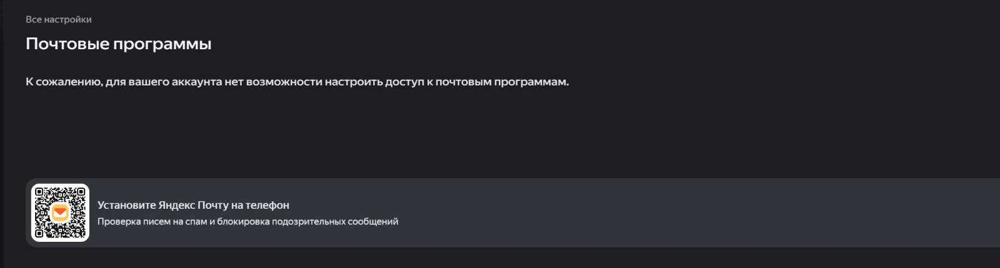
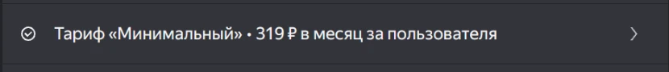
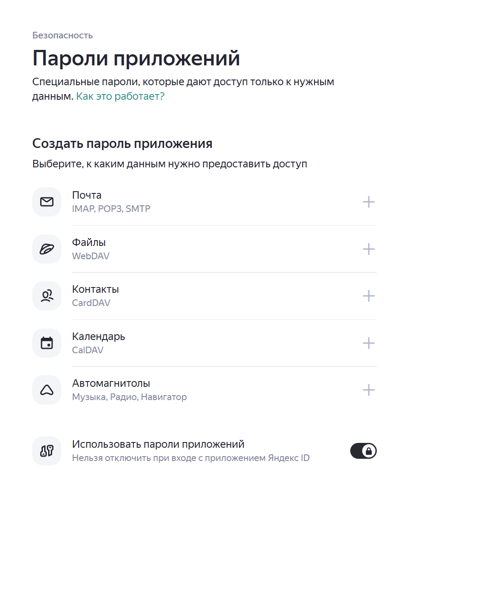

# Яндекс 360: как включить IMAP и создать пароль приложения

Для ящика в организации Яндекс 360 (почта на своём домене). Нужно сделать четыре вещи: подключить платный тариф,
включить IMAP для организации, включить IMAP в ящике и создать пароль приложения.

## 1. Проверить, есть ли доступ по IMAP

Зайдите в почту под нужным ящиком и откройте «Все настройки» → «Почтовые программы»:
https://mail.yandex.ru/#setup/client

Если там такое сообщение, IMAP для ящика закрыт:



Причин две, их надо проверить по порядку: нет платного тарифа или IMAP выключен для всей организации.

## 2. Платный тариф

С 29 июня 2023 года организации без платного тарифа не могут работать с почтой по IMAP, POP3 и SMTP. Остаются
только веб-версия и мобильное приложение.

Откройте кабинет организации: https://admin.yandex.ru → «Финансы» → «Оплата и тариф». Нужна строка с тарифом,
подойдёт самый дешёвый:



Если тарифа нет, подключите его там же.

## 3. IMAP для организации

Администратор организации может запретить почтовые программы сразу для всех ящиков. Это настройка `enable_imap`.
Если тариф есть, а сообщение из шага 1 осталось, значит, IMAP выключен здесь.

Включается через API 360. Нужен OAuth-токен администратора с правом `ya360_admin:mail_write_organization_setting`
(токен выдаёт приложение, созданное на https://oauth.yandex.ru) и ID организации:

```sh
curl -X PATCH "https://cloud-api.yandex.net/v1/admin/org/<ID организации>/mail-settings" \
  -H "Authorization: OAuth <токен администратора>" \
  -H "Content-Type: application/json" \
  -d '{"enable_imap": true}'
```

Описание настройки: https://yandex.ru/dev/api360/doc/ru/mail-settings/patch-settings. В кабинете организации
(https://admin.yandex.ru) такой переключатель тоже может быть, но где именно, мы не проверяли.

## 4. IMAP в ящике

Снова откройте «Почтовые программы» (https://mail.yandex.ru/#setup/client). Теперь там есть настройки:

- поставьте галочку «С сервера imap.yandex.ru по протоколу IMAP»;
- способ авторизации — «Пароли приложений и OAuth-токены»;
- сохраните.

## 5. Пароль приложения

Обычный пароль аккаунта по IMAP не подходит, нужен пароль приложения.

Откройте Яндекс ID → «Безопасность» → «Пароли приложений»: https://id.yandex.ru/security/app-passwords (справка
Яндекса даёт адрес https://passport.yandex.ru/security/app-passwords, он ведёт туда же)



1. Нажмите «+» справа от «Почта (IMAP, POP3, SMTP)».
2. Дайте паролю имя, например `mail-backup`.
3. Скопируйте пароль (16 символов). Яндекс покажет его один раз, поэтому сразу сохраните в менеджер паролей.

Положите пароль в `secrets/imap_password` (см. README, «Install»). Если пароль утёк или больше не нужен, удалите его
на той же странице.

## Настройки для бэкапа

```
IMAP_HOST=imap.yandex.ru
IMAP_PORT=993
IMAP_USER=<адрес ящика>
REFUSED_PATTERN=\[UNAVAILABLE\]
```

Особенности Яндекса — в README, раздел «Yandex 360 notes»:
- сессия живёт около 30 минут;
- часть писем сервер может не отдавать (`[UNAVAILABLE] … backend error`);
- лимит одновременных соединений не опубликован.
